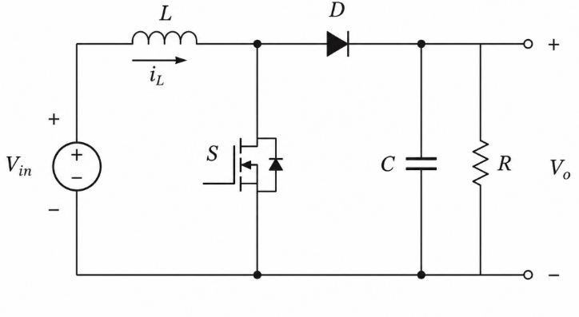
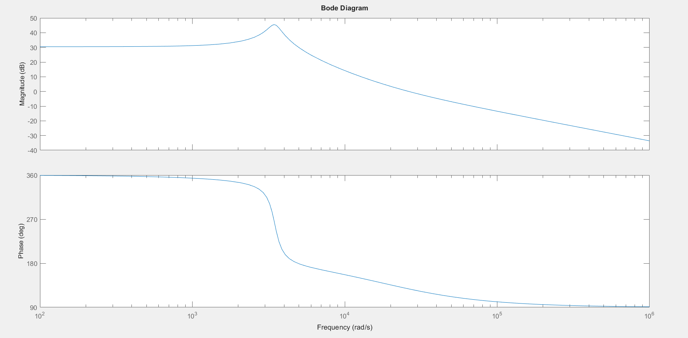
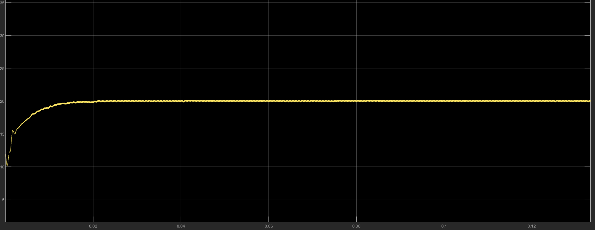
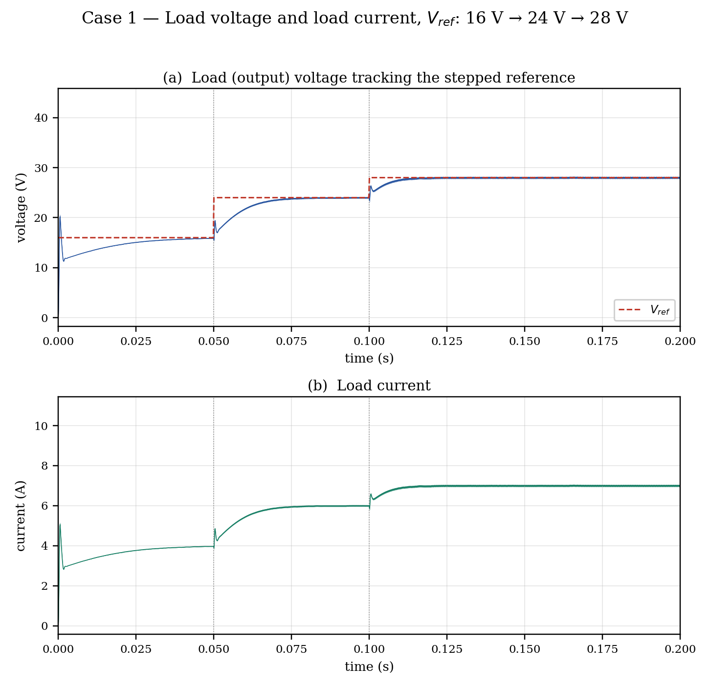
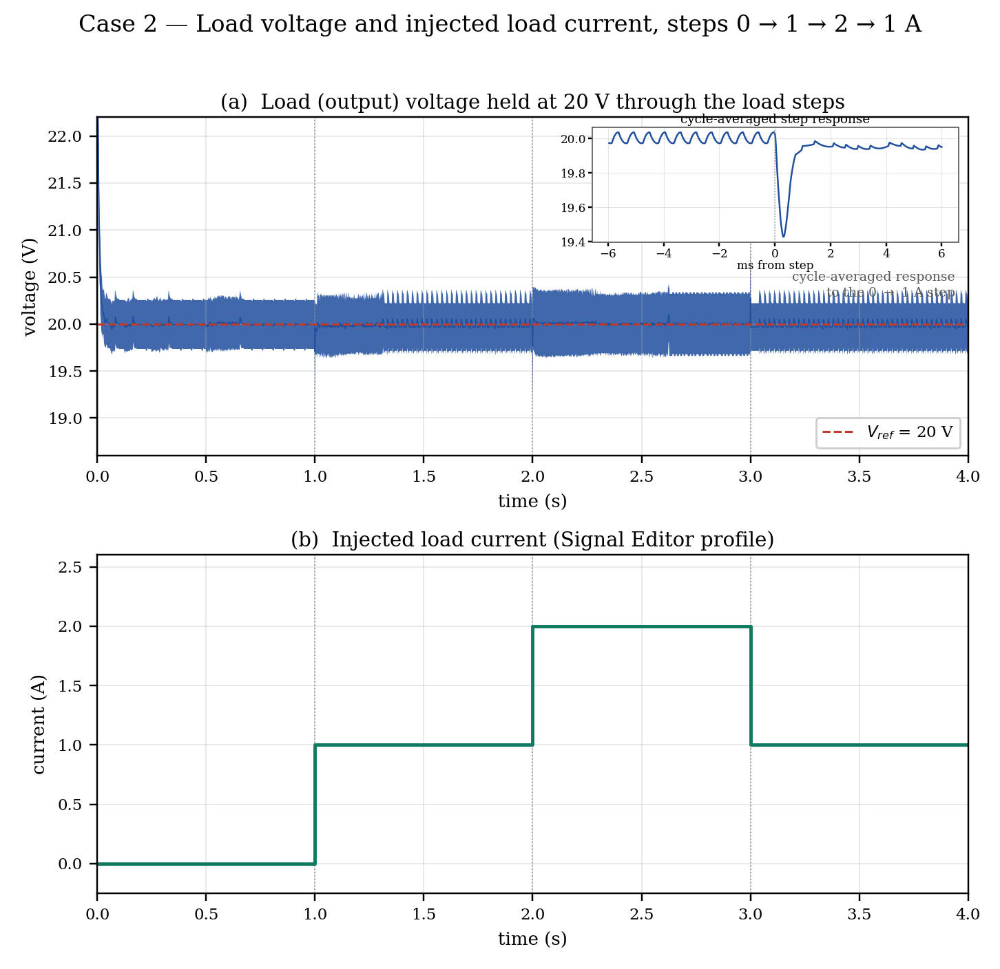
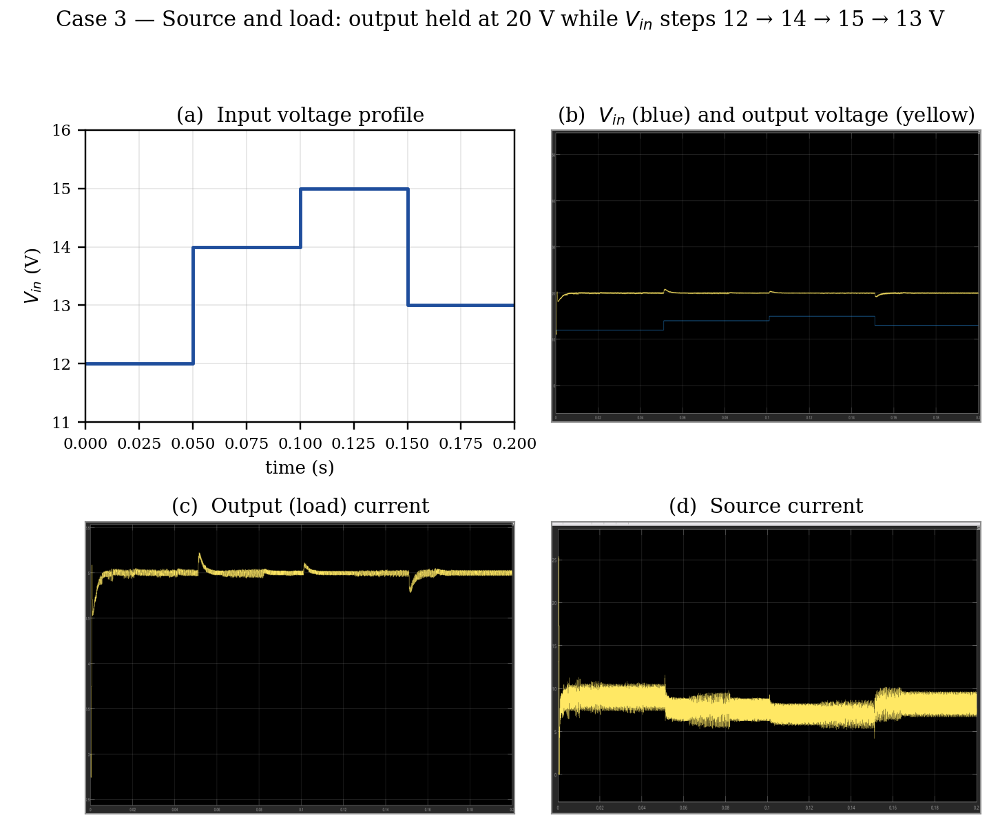

# Boost Converter Control Design

MATLAB and Simulink files for modeling and studying feedback control of a DC-DC boost converter, developed as a summer internship project. The project includes open-loop and closed-loop Simulink models, MATLAB control-analysis scripts, simulation signal data, and written design documentation.

## Project Contents

| File | Description |
| --- | --- |
| `open_loop.slx` | Open-loop converter model. |
| `closed_loop_.slx` | Closed-loop converter model. |
| `closed_loop_const_input.slx` | Closed-loop model with a constant input profile. |
| `closed_loop_load_curr.slx` | Closed-loop model for a load-current profile. |
| `closed_loop_Vref.slx` | Closed-loop model for a reference-voltage profile. |
| `PID_TUNER.m` | Defines the plant transfer function and opens MATLAB PID Tuner for PI design. |
| `bode_plot_closed_loop.m` | Builds a feedback transfer function and plots its frequency and step responses, margins, poles, zeros, and step-response metrics. |
| `boost_converter_control_design.html` | Detailed derivation and discussion of the small-signal model and candidate PID tuning. Open this file in a web browser. |
| `Bc_report.docx` | Project report. |
| `Boost_converter.pdf` | PDF design/reference document. |
| `figures/` | Circuit diagram, Simulink model screenshots, Bode plot, and simulation waveforms from the report. |
| `freq_resp.fig` | Saved MATLAB figure for frequency-response results. |
| `signal_editor.mat` | Signal Editor data for the Simulink models. |
| `signal_editor_load_curr (1).mat` | Load-current signal profile. |
| `signal_editor_Vref.mat` | Reference-voltage signal profile. |

## Results

All figures from the project report are in [`figures/`](figures/). Highlights:

**Boost converter power stage**



**Bode plot of the control-to-output transfer function Gvd(s)**



**Closed-loop output voltage regulated at the 20 V reference**



**Case 1: load voltage tracking reference steps 16 V → 24 V → 28 V**



**Case 2: load voltage under a load-current disturbance profile**



**Case 3: source and load quantities over the input-voltage profile**



<details>
<summary>Full figure list</summary>

| Figure | Description |
| --- | --- |
| `01_boost_converter_circuit.png` | Boost converter circuit diagram |
| `02_open_loop_simulink_model.png` | Open-loop Simulink model (`open_loop.slx`) |
| `03_open_loop_output_voltage_load_current.png` | Open loop: output voltage and load current at fixed duty ratio |
| `04_open_loop_inductor_diode_waveforms.png` | Open loop: inductor and diode voltage/current waveforms |
| `05_open_loop_capacitor_switch_waveforms.png` | Open loop: capacitor and switch waveforms |
| `06_bode_plot_Gvd.png` | Bode plot of the control-to-output transfer function Gvd(s) |
| `07_closed_loop_output_voltage_20V.png` | Closed-loop output voltage settling at 20 V |
| `08_case1_vref_simulink_model.png` | Case 1: Simulink model (`closed_loop_Vref.slx`) |
| `09_case1_vref_tracking_load_voltage.png` | Case 1: load voltage tracking the reference steps |
| `10_case1_inductor_diode_waveforms.png` | Case 1: inductor and diode waveforms |
| `11_case1_capacitor_source_switch_waveforms.png` | Case 1: capacitor, source and switch waveforms |
| `12_case2_load_current_simulink_model.png` | Case 2: Simulink model (`closed_loop_load_curr.slx`) |
| `13_case2_load_voltage_load_current_profile.png` | Case 2: load voltage and injected load-current profile |
| `14_case2_inductor_diode_waveforms.png` | Case 2: inductor and diode waveforms |
| `15_case2_capacitor_source_switch_waveforms.png` | Case 2: capacitor, source and switch waveforms |
| `16_case3_input_voltage_simulink_model.png` | Case 3: Simulink model (`closed_loop_.slx`) |
| `17_case3_source_load_quantities.png` | Case 3: source and load quantities over the input-voltage profile |
| `18_case3_inductor_diode_waveforms.png` | Case 3: inductor and diode waveforms |
| `19_case3_capacitor_switch_waveforms.png` | Case 3: capacitor and switch waveforms |

</details>

## Requirements

- MATLAB with Simulink.
- Control System Toolbox for the transfer-function analysis and PID Tuner workflow.
- A MATLAB release that can open the included `.slx` models and `.mat` files.

The models may also depend on block libraries or settings included with your MATLAB installation. If a model reports a missing block or variable, inspect the Diagnostic Viewer and confirm the required products are installed.

## Getting Started

1. Clone or download this repository and open its folder in MATLAB.
2. Set the folder as the MATLAB current folder, or add it to the MATLAB path.
3. Open a model such as `open_loop.slx` or one of the `closed_loop_*.slx` files in Simulink.
4. Check the model's Signal Editor/source configuration and confirm it points to the included signal data where applicable.
5. Run the model and inspect its Scope outputs.
6. To inspect the control-design notes, open `boost_converter_control_design.html` in a browser. To launch PID Tuner from MATLAB, run `PID_TUNER`.
7. To generate the plots and printed time-domain metrics in the analysis script, run `bode_plot_closed_loop`.

Run MATLAB scripts from the project folder so their data and saved figures are easy to locate. The scripts create figures and print results in the MATLAB Command Window; they do not automatically save new plot files.

## Design Notes

The HTML derivation documents a boost-converter example with a 20 V reference, 76.8 µH inductor, 400 µF capacitor, 4 Ω load, and 25 kHz switching frequency. It derives a small-signal control-to-output model using state-space averaging and discusses candidate PID gains of `Kp = 0.0116`, `Ki = 3.6`, and `Kd = 3e-6`.

Both MATLAB scripts use the same control-to-output plant model:

```
          -2.084e4 s + 4.023e8
G(s) = --------------------------
         s^2 + 625 s + 1.207e7
```

These values are design-note recommendations, not a guarantee that every included model uses those gains. The included `bode_plot_closed_loop.m` uses an integral-only controller from PID Tuner (`Kp = 0`, `Ki = 7.3324`); inspect each model's block parameters before comparing results. Validate stability, transient response, and operating limits in the target MATLAB/Simulink release before using the controller in hardware.

## Repository Notes

- Simulink models, MATLAB figures, and `.mat` signal data are included as project assets.
- Local MATLAB autosaves, Simulink caches, generated code, and operating-system metadata are excluded by `.gitignore`.
- No license is specified. Unless a license is added, reuse is subject to the default copyright rules.
